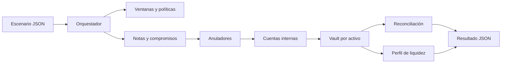

# NocturneDTL


NocturneDTL es un motor contable en Rust para posiciones privadas sobre un libro DTL. Representa depósitos como notas con compromisos deterministas, consume notas mediante anuladores, acredita cuentas internas y liquida retiros contra reservas por activo. El binario ejecuta escenarios JSON completos sin depender de servicios externos.

> Esta distribución es un motor local: no incorpora red P2P, contratos on-chain, custodia externa ni pruebas de conocimiento cero. Ninguna operación mueve activos fuera del proceso.

## Arquitectura



`src/scenario.rs` mantiene el contrato de entrada/salida; `src/ledger.rs` coordina transiciones; `src/privacy.rs` construye compromisos; `src/withdrawal.rs` aplica límites; `src/reconcile.rs` publica saldos agregados. `src/liquidity.rs` calcula capacidad bajo estrés sin modificar el ledger.

## Puesta en marcha

Requiere Rust compatible con `Cargo.toml` y Node.js 22 para las pruebas de integración.

```bash
cargo build --locked
cargo run --locked --quiet -- --json < escenario.json
bash scripts/ci.sh
```

Ejemplo de `escenario.json`:

```json
{
  "operations": [
    { "op": "deposit", "note": "n1", "owner": "alice", "account": "alice-main", "asset": "DTL", "amount": 350, "position": "p1", "window": 1, "blinding": "apertura-local-1" },
    { "op": "spend", "note": "n1", "recipient": "alice-main", "memo": "liquidación interna" },
    { "op": "withdraw", "account": "alice-main", "asset": "DTL", "amount": 200, "destination": "dtl:alice", "window": 1 },
    { "op": "reconcile" }
  ]
}
```

La salida incluye `notes`, `receipts`, `snapshot`, `reconciliations` y `liquidity_profiles`. Las cantidades son unidades enteras del activo; la escala decimal la define su registro.

## Modelo económico

Por activo se observa `depósitos = retiros + reservas`. El perfil de liquidez aplica un recorte de estrés de 2.000 puntos básicos: `reserva_estresada = floor(reserva × 8.000 / 10.000)`. La capacidad observada es el mínimo entre esa reserva y el límite por solicitud de la política de retiros. En el ejemplo, depósito 350 y retiro 200 dejan reserva 150, reserva estresada 120 y capacidad observada 120. Este cálculo es informativo: no autoriza por sí mismo un retiro.

La conservación agregada es una señal operacional, no una prueba de solvencia de cada posición. La revisión de autorizaciones, dominio de anuladores y exposición individual se hace por separado.

## Documentación

- [Arquitectura y estados](docs/arquitectura.md)
- [Modelo económico y límites](docs/modelo-economico.md)
- [Operación y validación](docs/operacion.md)
- [Política de seguridad](SECURITY.md)

## Versionado

La rama `production`, el tag anotado `v1.0.0` y la publicación `Production 1.0.0` identifican la misma revisión del motor local. Véase [CHANGELOG.md](CHANGELOG.md).
