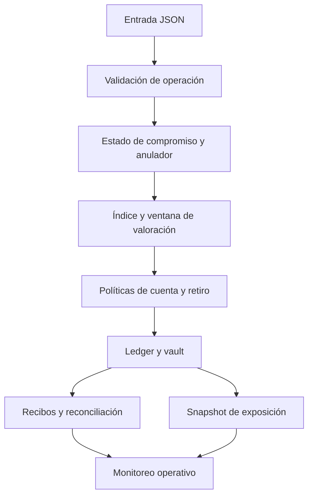

# Política de seguridad

## Alcance

Se revisan las transiciones Rust, el contrato JSON, las políticas de admisión y retiro, la integridad de notas/anuladores y la contabilidad por activo. El motor es local y no ofrece servicio público ni custodia externa. Una prueba verde demuestra que se ejecutaron las comprobaciones previstas, no que el diseño carezca de riesgos.

## Comunicación responsable

Si detectas un problema, utiliza el canal privado de avisos de seguridad de GitHub del repositorio, cuando esté habilitado. No publiques detalles explotables en una issue o un PR antes de coordinar la revisión. Incluye revisión afectada, precondiciones, entrada JSON mínima, resultado observado, resultado esperado e impacto contable. No compartas aperturas secretas ni datos ajenos en canales públicos.

## Controles de esta distribución

| Control | Qué verifica | Límite |
| --- | --- | --- |
| Formato, compilación y Clippy | Integridad de build y reglas de lint | No evalúa lógica económica |
| Tests Rust y Node.js | Transiciones y contrato externo conocidos | Cobertura no exhaustiva |
| Compromisos y anuladores | Archivo de la nota anterior, unicidad de posición y consumo de identificadores | No sustituye una revisión integral del ciclo de vida |
| Índice por ventanas | Composición de tasas, límites de salto y aritmética comprobada | La financiación de rendimientos se registra por separado |
| Fondeo de tesorería | Identidad del operador, activo, ventana y recibo | No demuestra suficiencia futura de capital |
| Política de retiro | Mínimo y máximo por solicitud | No sustituye análisis de solvencia |
| Reconciliación | Conservación agregada por activo | No certifica exposición individual |
| Perfil de liquidez | Reserva y capacidad bajo recorte de 2.000 bps | Métrica informativa, no bloqueo |

Antes de distribuir una revisión, ejecutar `bash scripts/ci.sh`, inspeccionar dependencias y comprobar que `main`, `production` y el tag publicado resuelven al mismo commit.
