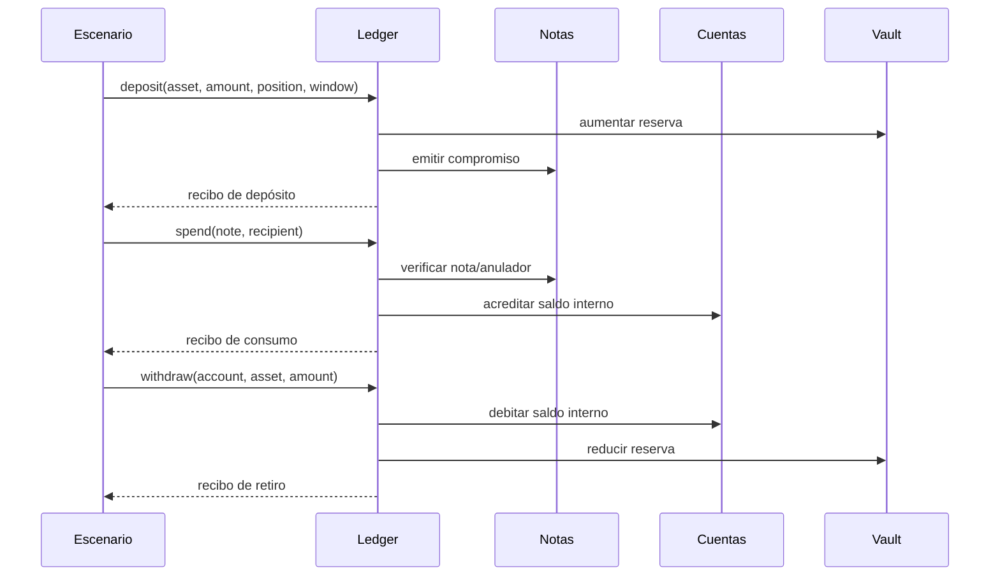

# Arquitectura y ciclo de una posición

El binario `nocturnedtl` lee un escenario JSON y lo procesa en un único proceso. `ScenarioInput.operations` conserva el orden: cada operación se aplica al estado resultante de la anterior. Un error detiene la simulación y no publica un resultado parcial.

Una nota contiene el contexto que permite abrir un compromiso; la salida pública expone su vista pública, no el secreto de apertura. Una ventana agrupa operaciones bajo un ancla. La rotación crea una nota para una ventana posterior y debe auditarse como transición de la misma posición económica, además de comprobar la validez técnica de cada compromiso.

`LedgerSnapshot.audit.exposures` agrega principal, compromisos y valores activos/consumidos por posición. La reconciliación agrega depósitos, retiros, reservas y saldos por activo. Son proyecciones distintas: exposición individual y conservación global.

| Operación | Campos principales | Resultado observable |
| --- | --- | --- |
| `deposit` | propietario, cuenta, activo, monto, posición, ventana, apertura | nota y recibo |
| `roll` | nota fuente, nueva etiqueta, ventana, apertura | nueva vista pública |
| `spend` | nota, destinatario, memo | crédito y recibo |
| `withdraw` | cuenta, activo, monto, destino, ventana | débito y recibo |
| `reconcile` | ninguno | reporte agregado |

Los montos de entrada son enteros positivos de hasta 64 bits; internamente `Amount` usa aritmética de 128 bits. `snapshot` no muta el estado. Las etiquetas de nota pertenecen al escenario, no son identificadores globales.
