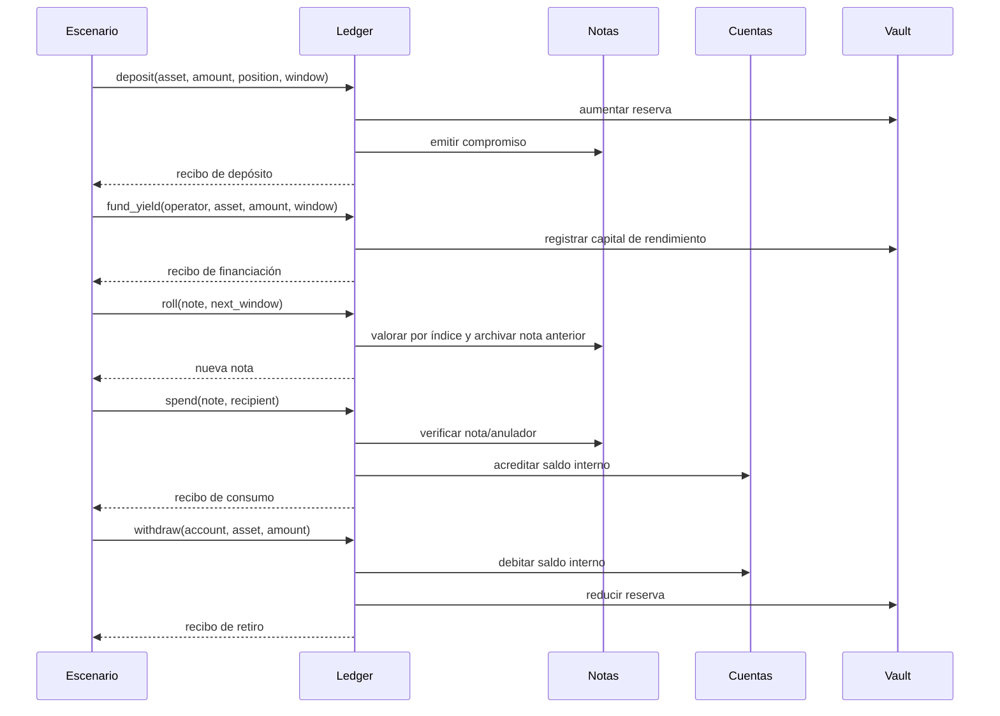

# Arquitectura y ciclo de una posición

El binario `nocturnedtl` lee un escenario JSON y lo procesa en un único proceso. `ScenarioInput.operations` conserva el orden: cada operación se aplica al estado resultante de la anterior. Un error detiene la simulación y no publica un resultado parcial.

Una nota contiene el contexto que permite abrir un compromiso; la salida pública expone su vista pública, no el secreto de apertura. Una ventana agrupa operaciones bajo un ancla. La rotación exige una ventana posterior dentro del salto configurado, archiva el compromiso de origen y crea la nota siguiente. Una posición solo se abre una vez. La curva de rendimiento calcula valores enteros con redondeo hacia abajo; la aportación de tesorería aumenta las reservas sin emitir una nota de usuario.

`LedgerSnapshot.audit.exposures` agrega principal y valores activos, archivados y consumidos por posición. La reconciliación agrega entradas, retiros, reservas y saldos por activo, separando las tres clases de compromisos. Son proyecciones distintas: exposición individual y conservación global.

| Operación | Campos principales | Resultado observable |
| --- | --- | --- |
| `deposit` | propietario, cuenta, activo, monto, posición, ventana, apertura | nota y recibo |
| `roll` | nota fuente, nueva etiqueta, ventana, apertura | nueva vista pública |
| `fund_yield` | operador, activo, monto, ventana | reserva y recibo de tesorería |
| `spend` | nota, destinatario, memo | crédito y recibo |
| `withdraw` | cuenta, activo, monto, destino, ventana | débito y recibo |
| `reconcile` | ninguno | reporte agregado |

Los montos de entrada son enteros positivos de hasta 64 bits; internamente `Amount` usa aritmética de 128 bits. `snapshot` no muta el estado. Las etiquetas de nota pertenecen al escenario, no son identificadores globales.
