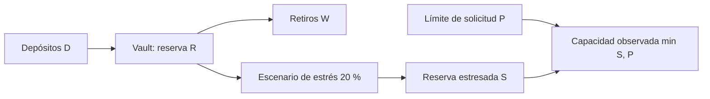

# Modelo económico y capacidad de retiro

El vault mantiene, por activo, depósitos acumulados `D`, retiros acumulados `W` y reserva `R`. Su conservación nominal es `D = W + R`. Las cuentas internas representan valor acreditado después del consumo de una nota; no equivalen a reservas adicionales.

Para un recorte `h` en puntos básicos, `S = floor(R × (10.000 - h) / 10.000)`. Esta versión usa `h = 2.000`. La pérdida bajo estrés es `R - S`, y la capacidad observada `min(S, límite_diario)`. Ejemplo: `D=350`, `W=200`, `R=150` producen `S=120`, pérdida 30 y capacidad 120 si el límite supera 120. El redondeo es hacia abajo en unidades enteras.

La capacidad es una proyección posterior al escenario: no reserva liquidez ni modifica el vault. La validación de retiro real usa saldo de cuenta, política aplicable y reserva en el momento de la operación.

- `reconciliations[].balanced` confirma conservación del vault por activo; no demuestra unicidad de valor por posición.
- `snapshot.audit.exposures` permite contrastar principal con compromisos emitidos, activos y consumidos.
- `liquidity_profiles[].nominal_conservation` refleja la ecuación nominal; `stressed_reserve` y `observed_capacity` muestran el estrés hipotético.

Para revisar políticas, comparar estas tres vistas sobre las mismas operaciones y registrar la revisión exacta del código.
