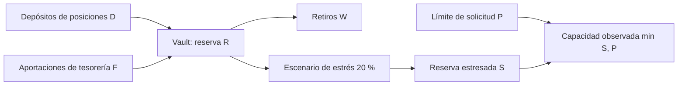

# Modelo económico y capacidad de retiro

El vault mantiene, por activo, depósitos de posiciones `D`, aportaciones de tesorería `F`, retiros acumulados `W` y reserva `R`. Su conservación nominal es `D + F = W + R`. Las cuentas internas representan valor acreditado después del consumo de una nota; no equivalen a reservas adicionales. El campo `deposits` del reporte agregado incluye `D + F`; los recibos permiten separar sus orígenes.

Para un recorte `h` en puntos básicos, `S = floor(R × (10.000 - h) / 10.000)`. Esta versión usa `h = 2.000`. La pérdida bajo estrés es `R - S`, y la capacidad observada `min(S, límite_diario)`. Ejemplo: `D=350`, `W=200`, `R=150` producen `S=120`, pérdida 30 y capacidad 120 si el límite supera 120. El redondeo es hacia abajo en unidades enteras.

El índice por ventanas es independiente del recorte de estrés. Su función es valorar una nota cuando se rota a una ventana posterior. La curva usa un índice inicial de `10¹²`, tasas configurables por ventana y aritmética comprobada de 128 bits. Las reservas para pagar rendimientos proceden de `fund_yield`, operación identificada por operador, activo, ventana y recibo. Véase [Índice por ventanas y financiación](indice-y-fondeo.md).

La capacidad es una proyección posterior al escenario: no reserva liquidez ni modifica el vault. La validación de retiro real usa saldo de cuenta, política aplicable y reserva en el momento de la operación.

- `reconciliations[].balanced` confirma conservación del vault por activo; no demuestra que las obligaciones individuales estén cubiertas.
- `snapshot.audit.exposures` permite contrastar principal con compromisos emitidos, activos, archivados y consumidos.
- `liquidity_profiles[].nominal_conservation` refleja la ecuación nominal; `stressed_reserve` y `observed_capacity` muestran el estrés hipotético.

Para revisar políticas, comparar estas tres vistas sobre las mismas operaciones y registrar la revisión exacta del código.
